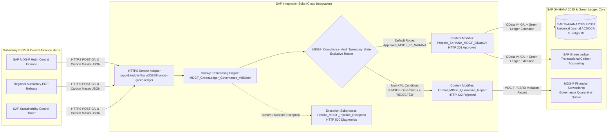
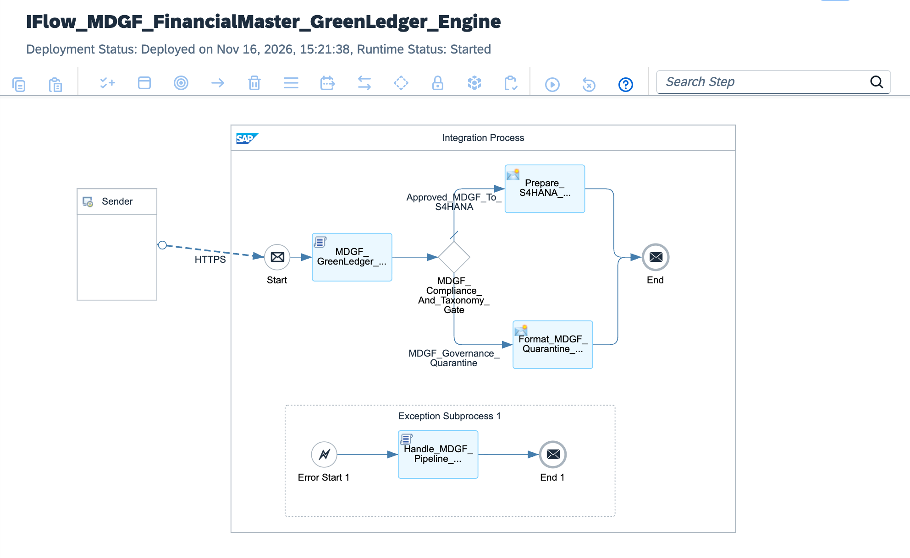

# SAP S/4HANA 2025 MDG-F Financial Master & Green Ledger Governance Mesh

[-008FD3?style=for-the-badge&logo=sap&logoColor=white)](https://help.sap.com/docs/cloud-integration)
[](https://api.sap.com/)
[](https://www.sap.com/products/financial-management/green-ledger.html)
[](https://groovy-lang.org/)
[](https://spockframework.org/)

## Executive Overview

In global **SAP S/4HANA 2025 FPS01** finance transformations, **Master Data Governance for Financials (MDG-F)** governs the creation and distribution of General Ledger (`G/L`) accounts, Cost Centers, and Profit Centers feeding the **Universal Journal (`ACDOCA`)**. With the introduction of **SAP Green Ledger** and mandatory **EU Corporate Sustainability Reporting Directive (CSRD / ESRS E1)** disclosures in 2026–2027, financial master data now carries carbon accounting attributes (`Scope 1`, `Scope 2`, `Scope 3` GHG categories and `tCO2e`/`kgCO2e` units) alongside statutory monetary dimensions.

Allowing regional subsidiaries or external ERP consolidators to push unvalidated `G/L` account definitions into central S/4HANA instances creates severe chart-of-accounts (`YCOA`) range conflicts, invalid account types (`X`, `N`, `P`, `S`, `C`), currency mismatches in Ledger `0L`, and non-auditable carbon postings. This repository delivers a production-grade **SAP Cloud Integration (CPI)** governance pipeline that enforces **MDG-F** and **SAP Green Ledger** taxonomy rules prior to **S/4HANA 2025 OData V4 (`A_GLAccountInChartOfAccounts`)** persistence.

---

## End-to-End Architecture Flow



## SAP Cloud Integration (CPI) BPMN2 Integration Flow



---

## Core Architectural Capabilities

### 1. S/4HANA Universal Journal (`ACDOCA`) Account Type & `YCOA` Range Enforcement
Validates every inbound `G/L` account against **SAP S/4HANA 2025** structural rules before database persistence:
- Enforces 6-to-10 digit numeric `GLAccount` formatting and valid S/4HANA `GLAccountType` classifications (`X` Balance Sheet, `N` Non-Operating Expense/Income, `P` Primary Costs/Revenue, `S` Secondary Costs, `C` Cash Account).
- Prevents range collisions in `YCOA` by verifying that Balance Sheet/Cash accounts (`X`, `C`) begin with leading digits `1–3`, while P&L/Controlling accounts (`P`, `S`, `N`) begin with `4–9`.

### 2. SAP Green Ledger & EU CSRD / ESRS E1 Taxonomy Validation
When `IsGreenLedgerCarbonAccount` is enabled, the engine enforces **2026/2027 SAP Green Ledger** and **EU ESRS E1** compliance rules:
- Validates `GhgScopeCategory` against standardized GHG Protocol scopes (`SCOPE_1`, `SCOPE_2_LOCATION`, `SCOPE_2_MARKET`, `SCOPE_3_UPSTREAM`, `SCOPE_3_DOWNSTREAM`).
- Verifies `CsrdEsrsStandard` alignment (`ESRS_E1_6` Gross Scopes 1, 2, 3 GHG emissions or `ESRS_E1_7` GHG removals and carbon credits).
- Enforces carbon units of measure (`TCO2E` or `KGCO2E`) and restricts carbon accounts strictly to Primary (`P`) or Secondary (`S`) cost account types for `CO-PA` and `ACDOCA` profitability allocation.

### 3. Ledger `0L` Currency, Company Code & Temporal Interval Governance
- Validates 4-character alphanumeric `CompanyCode` identifiers and restricts posting currencies to approved **ISO 4217** codes configured for Leading Ledger `0L`.
- Parses `ValidFrom` and `ValidTo` using `java.time.LocalDate` to block inverted or malformed fiscal validity intervals.

### 4. Deterministic SHA-256 MDG-F Golden Key Fingerprinting
Computes a canonical 64-character **SHA-256** hash (`X-MDGF-Golden-Hash`) across `ChartOfAccounts|CompanyCode|GLAccount|GLAccountType|CostCenter|ProfitCenter|GhgScopeCategory` to guarantee idempotent master data replication across multi-ERP landscapes.

---

## BPMN2 Integration Flow Architecture

| Step | Component Type | Artifact / Step Name | Technical Configuration & Responsibility |
| :--- | :--- | :--- | :--- |
| **1** | **Sender Adapter** | `HTTPS` | Endpoint: `/api/v1/mdgf/s4hana2025/financial-green-ledger`, Role-Based Auth (`ESBMessaging.send`). |
| **2** | **Groovy Script 1** | `MDGF_GreenLedger_Governance_Validator` | Streams JSON via `java.io.Reader`, validates `YCOA` ranges, `ACDOCA` account types, ISO 4217 currency, and SAP Green Ledger CSRD tags. |
| **3** | **Exclusive Router** | `MDGF_Compliance_And_Taxonomy_Gate` | Evaluates `X-MDGF-Gate-Status`. Default route forwards approved G/L entities; non-XML condition `${header.X-MDGF-Gate-Status} = 'REJECTED'` routes violations. |
| **4a** | **Content Modifier** | `Prepare_S4HANA_MDGF_ODataV4` | Sets `Content-Type: application/json` and `CamelHttpResponseCode: 201` for S/4HANA 2025 OData V4 ingestion. |
| **4b** | **Content Modifier** | `Format_MDGF_Quarantine_Report` | Sets `Content-Type: application/json` and `CamelHttpResponseCode: 422` for MDG-F Stewardship quarantine. |
| **5** | **Exception Subprocess** | `Handle_MDGF_Pipeline_Exception` | Captures `CamelExceptionCaught` runtime faults and returns structured `HTTP 500` JSON diagnostics. |

---

## Payload Contracts & Runtime Verification

### Scenario A: Valid Green Ledger Primary Cost Account (`HTTP 201 Approved`)

**Inbound Request (`POST /http/api/v1/mdgf/s4hana2025/financial-green-ledger`):**
```json
{
  "CompanyCode": "DE01",
  "ChartOfAccounts": "YCOA",
  "GLAccount": "61004500",
  "GLAccountName": "Scope 1 Industrial Natural Gas Carbon Allocation",
  "GLAccountType": "P",
  "Currency": "EUR",
  "CostCenter": "CC-MFG-01",
  "ProfitCenter": "PC-EMEA-EV",
  "ValidFrom": "2026-01-01",
  "ValidTo": "9999-12-31",
  "IsGreenLedgerCarbonAccount": true,
  "GhgScopeCategory": "SCOPE_1",
  "CsrdEsrsStandard": "ESRS_E1_6",
  "EmissionUnit": "TCO2E"
}
```

**Outbound S/4HANA 2025 OData V4 + Green Ledger Payload (`HTTP 201`):**
```json
{
  "@odata.context": "$metadata#A_GLAccountInChartOfAccounts/$entity",
  "ChartOfAccounts": "YCOA",
  "GLAccount": "61004500",
  "GLAccountType": "P",
  "CompanyCode": "DE01",
  "Currency": "EUR",
  "ValidityStartDate": "2026-01-01",
  "ValidityEndDate": "9999-12-31",
  "MDGFGoldenFingerprint": "7c4e9a1b2d8f6035e1a9c4f7b2d5e8a1c3f6b9d2e5a8c1f4b7d0e3a6c9f2b5d8",
  "to_Text": [
    {
      "Language": "EN",
      "GLAccountName": "Scope 1 Industrial Natural Gas Carbon Allocation",
      "GLAccountLongName": "Scope 1 Industrial Natural Gas Carbon Allocation"
    }
  ],
  "to_ControllingAssignment": {
    "CostCenter": "CC-MFG-01",
    "ProfitCenter": "PC-EMEA-EV"
  },
  "SAPGreenLedgerExtension": {
    "CarbonAccountingEnabled": true,
    "GhgProtocolScope": "SCOPE_1",
    "CsrdDisclosureTag": "ESRS_E1_6",
    "CarbonUnitOfMeasure": "TCO2E",
    "LedgerTarget": "0L_GREEN_UNIVERSAL_JOURNAL"
  }
}
```

---

### Scenario B: `YCOA` Range Collision & Invalid CSRD Taxonomy (`HTTP 422 Rejected`)

**Inbound Request:**
```json
{
  "CompanyCode": "DE01",
  "ChartOfAccounts": "YCOA",
  "GLAccount": "11002000",
  "GLAccountName": "Misclassified Carbon Offset Account",
  "GLAccountType": "X",
  "Currency": "EUR",
  "IsGreenLedgerCarbonAccount": true,
  "GhgScopeCategory": "SCOPE_4_INVALID",
  "CsrdEsrsStandard": "ESRS_S1",
  "EmissionUnit": "LITERS"
}
```

**Outbound MDG-F Quarantine Report (`HTTP 422`):**
```json
{
  "status": "QUARANTINED_MDGF_GOVERNANCE_HOLD",
  "framework": "SAP_S4HANA_2025_MDGF_AND_GREEN_LEDGER_CSRD",
  "timestamp": "2026-11-16T14:22:10Z",
  "companyCode": "DE01",
  "chartOfAccounts": "YCOA",
  "glAccount": "11002000",
  "mdgfGoldenSha256": "5a9f2c1d8e4b7036a1c3e5f7b9d2a4c6e8f0b1d3a5c7e9f1b3d5a7c9e1f3b5d7",
  "violations": [
    "GREEN_LEDGER_INVALID_SCOPE: GhgScopeCategory [SCOPE_4_INVALID] is invalid for SAP Green Ledger carbon posting.",
    "CSRD_TAXONOMY_MISMATCH: CsrdEsrsStandard [ESRS_S1] must align with ESRS_E1_6 or ESRS_E1_7.",
    "INVALID_CARBON_UOM: EmissionUnit [LITERS] must be TCO2E or KGCO2E.",
    "GREEN_LEDGER_ACCOUNT_TYPE_ERROR: Carbon emission accounts must use GLAccountType P (Primary) or S (Secondary), found [X]."
  ]
}
```

---

## Local Test-Driven Development (Spock Framework)

All Groovy 3 `Reader`-streamed validation rules, `YCOA` account range assertions, and SAP Green Ledger CSRD checks are verified locally via **Gradle** and **Spock Framework 2.3**:

```bash
gradle test --info
```

### Verified Test Specifications (`MdgfGreenLedgerValidatorSpec.groovy`)
- `Should approve valid S/4HANA 2025 Green Ledger G/L account and generate OData V4 payload with SHA-256 fingerprint`
- `Should reject G/L account violating YCOA Balance Sheet vs P&L leading digit range`
- `Should quarantine Green Ledger carbon account failing EU CSRD ESRS E1 taxonomy or account type rules`

---

## Repository Structure

```text
sap-cpi-mdg-financial-master-green-ledger-mesh/
├── artifacts/
│   └── IFlow_MDGF_FinancialMaster_GreenLedger_Engine.zip   # Exported SAP CPI BPMN2 package
├── docs/
│   └── adr/
│       └── 001-mdgf-green-ledger-csrd-taxonomy-gating.md
├── src/
│   ├── main/
│   │   └── groovy/
│   │       ├── MDGF_GreenLedger_Governance_Validator.groovy  # Groovy 3 streaming MDG-F & Green Ledger validator
│   │       └── Handle_MDGF_Pipeline_Exception.groovy         # Structured HTTP 500 error handler
│   └── test/
│       └── groovy/
│           ├── com/sap/gateway/ip/core/customdev/util/
│           │   └── Message.groovy                            # SAP CPI Message stub (Reader-enabled)
│           └── MdgfGreenLedgerValidatorSpec.groovy           # Spock Framework TDD unit tests
├── build.gradle                                              # Groovy 3 & Spock 2.3 build descriptor
├── iflow-bpmn2-diagram.png                                   # SAP CPI BPMN2 flow screenshot
└── README.md
```

---

**Author:** Željko Popov  
*Integration & SAP S/4HANA Clean Core Architect*
